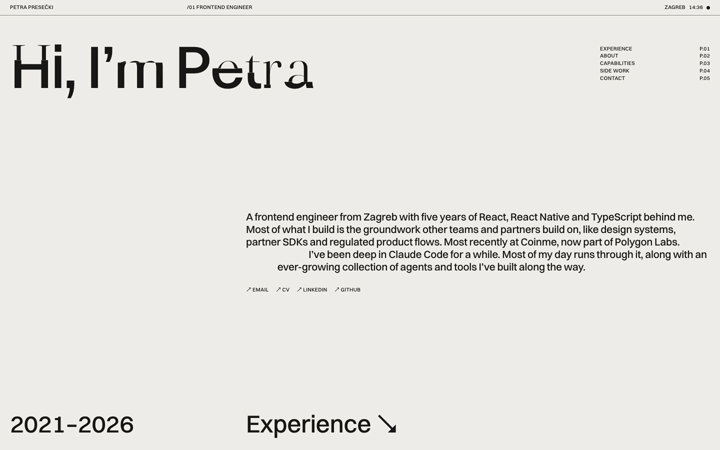

# petra-presecki-portfolio



Portfolio of Petra Presečki, frontend and product engineer. Live at [petra-presecki.pages.dev](https://petra-presecki.pages.dev/).

React 19, TypeScript, Vite, Tailwind 4, GSAP and Lenis, with blocks from my creative-kit (scramble text, roll text, column curtain).

```sh
pnpm install
pnpm dev
pnpm build   # VITE_IVA_URL / VITE_BYKRESO_URL override the live links
```

- `src/data/site.ts`: every word on the site
- `src/components/`: the page, the full-screen view for a closer look at Coinme work and side projects, and the interactive demos (design system, flows, agents)
- `cv/cv.html`: the CV; `pnpm cv` prints it to `public/Petra-Presecki-CV.pdf` (A4, two pages) with the installed Chrome. `pnpm cv <file>` prints a tailored copy next to its source (`applications/` is gitignored)
- `public/llms.txt`: the site's facts for AI agents; keep it in step with `src/data/site.ts`
- `public/work/clips/`: the recordings, made by `scripts/record.mjs` from the real sites at 2x through Chrome's screencast (`scripts/screencast.mjs`)

Deployed to Cloudflare Pages: `wrangler pages deploy dist --project-name petra-presecki --branch main`.
